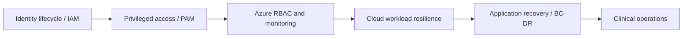

# Project 09 — Integrated IAM, PAM, Azure Cloud Security & BC/DR Assurance

> **Fictional case study.** PrairieTrust Healthcare Services (PTHS) and all evidence, populations, control results, risk assessments, and management roles are **synthetic**. This portfolio demonstrates analytical methodology, not production system access, actual audits, HIPAA certification, or professional employment experience.

## Executive summary

This capstone integrates 30 synthetic observations across identity lifecycle governance (IAM-01–06), privileged access management (PAM-01–08), Azure cloud governance (CLD-01–08), and business continuity/disaster recovery (BCDR-01–08). It separates confirmed exceptions, Azure Policy evaluation findings, open security recommendations, assurance limitations, and unsupported management claims.

**Qualified assurance conclusion:** The supplied evidence does not establish enterprise-wide control effectiveness. It also does not establish an actual security breach, patient data exposure, production outage, patient data loss, or HIPAA violation.

## Key observations

| Evidence | Synthetic result | Appropriate conclusion |
|---|---|---|
| IAM-01 | 12/120 terminated EHR accounts remained active beyond 24 hours | Confirmed deprovisioning exception; misuse unverified |
| PAM-04 | 4/25 CyberArk credentials exceeded 30-day rotation | Confirmed exception, subject to valid approved exception review |
| CLD-02 | 4/30 storage accounts failed anonymous-access Azure Policy evaluation | Policy-evaluation finding; actual exposure unverified |
| CLD-03 | Two high-severity Defender recommendations open | Technical validation required; Secure Score 82% is not compliance |
| BCDR-01 | EHR RTO 13 hours vs 8-hour target | Confirmed recovery-test failure, not production outage |
| BCDR-02 | EHR RPO 6 hours vs 4-hour target | Confirmed recovery-test failure, not actual data loss |

## Visual: cross-domain control dependencies

## Visual: EHR recovery objective gaps

```mermaid
xychart-beta
    title "EHR recovery test vs approved objectives (hours)"
    x-axis [RTO, RPO]
    y-axis "Hours" 0 --> 14
    bar [8, 4]
    bar [13, 6]
```

The first bar series shows **approved objectives** (RTO 8h, RPO 4h); the second shows **observed test results** (RTO 13h, RPO 6h). An observed RPO of six hours is *potential data loss in the test*, not a confirmed production loss.

## Deliverables

| File | Contents |
|---|---|
| `Integrated_Assurance_Report.pdf` | Consolidated findings, five risks, cross-domain relationships and audit work program |
| `Enterprise_Risk_Register.xlsx` | Five provisional High risks, evidence index, owners, treatments and independent closure criteria |
| `Remediation_Roadmap.xlsx` | Corrected immediate response and 30/60/90-day management/assurance plan |
| `Audit_Committee_Brief.pdf` | Executive-level assurance conclusions, accountability and decision needs |

## Method and guardrails

1. Validate populations, policies and authoritative logs before forming findings.
2. Separate observed exceptions from missing evidence and unsupported management assertions.
3. Score likelihood and impact provisionally; revise after technical validation.
4. Management owns remediation; independent audit validates findings and closure.
5. Preserve historical test failures even after successful remediation.
6. Do not infer a HIPAA violation from technical observations alone.

**Framework orientation:** NIST CSF 2.0, NIST SP 800-53, NIST SP 800-34, ISO/IEC 27001:2022, ISO 22301, and relevant HIPAA Security Rule safeguards. Framework references are educational mappings, not an attestation of compliance.

## Portfolio visuals and screenshots

The Mermaid diagrams above are original, synthetic explanatory visuals. Do not upload screenshots of live employer, patient, identity, or tenant data. Future interface walkthroughs should use synthetic mockups clearly labeled as illustrations or properly authorized screenshots.
